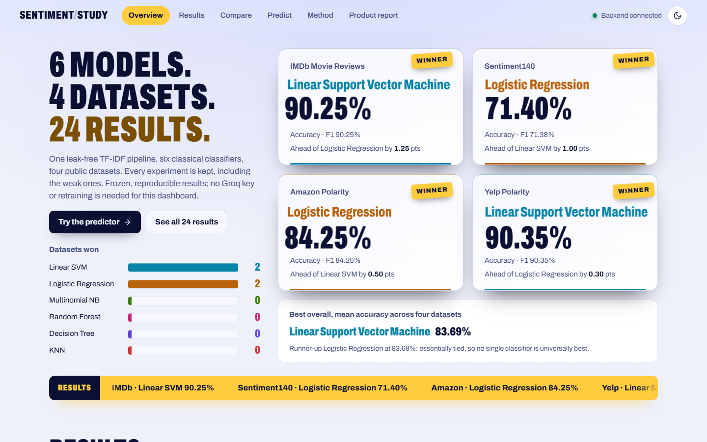
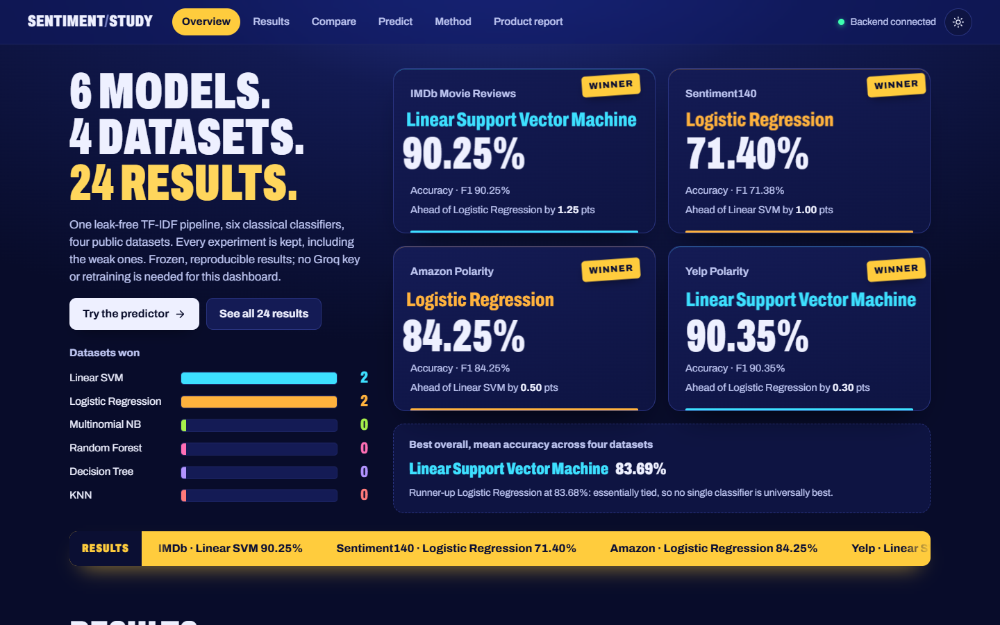
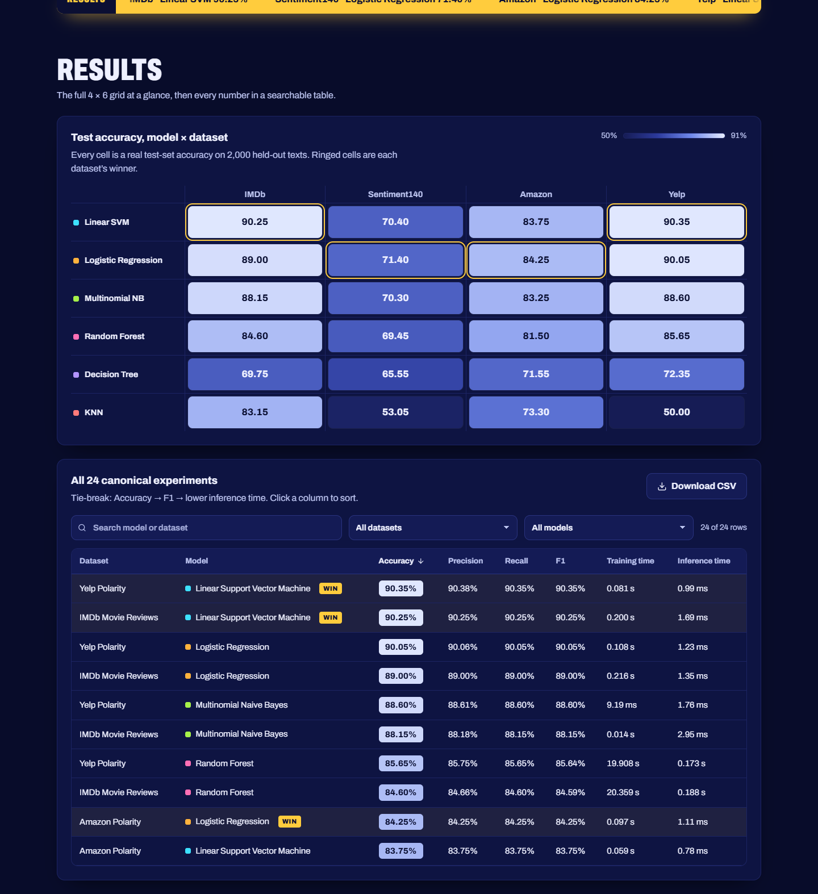
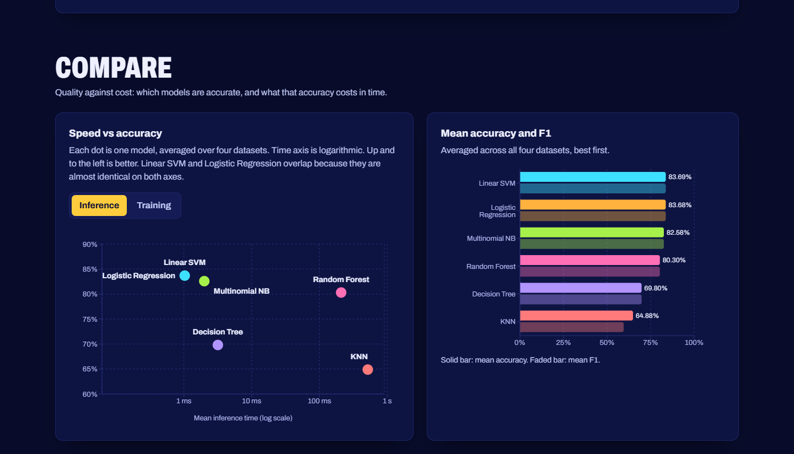
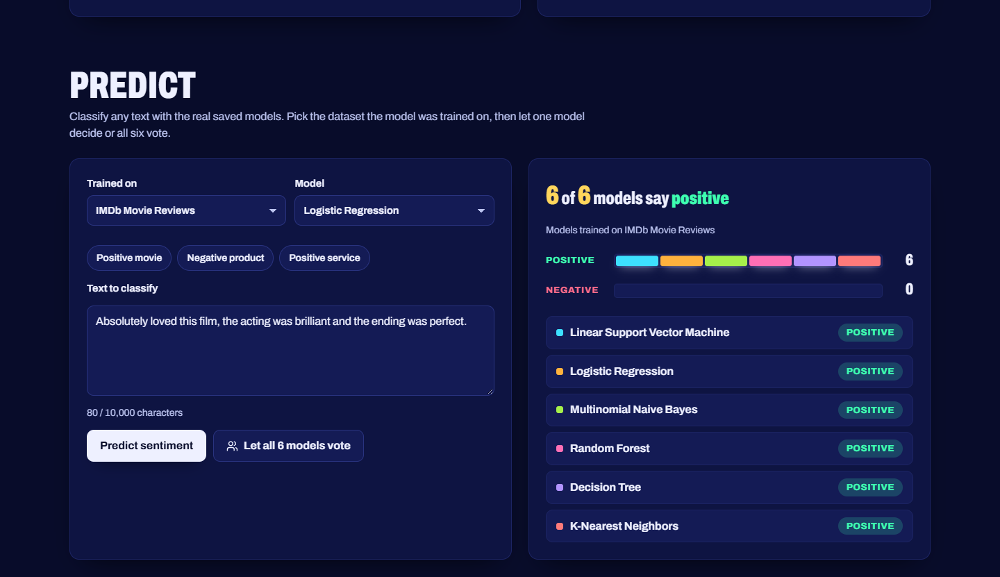
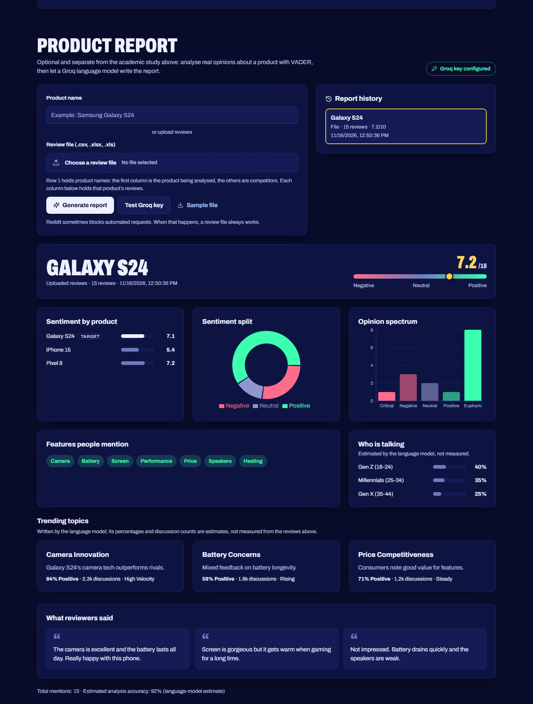
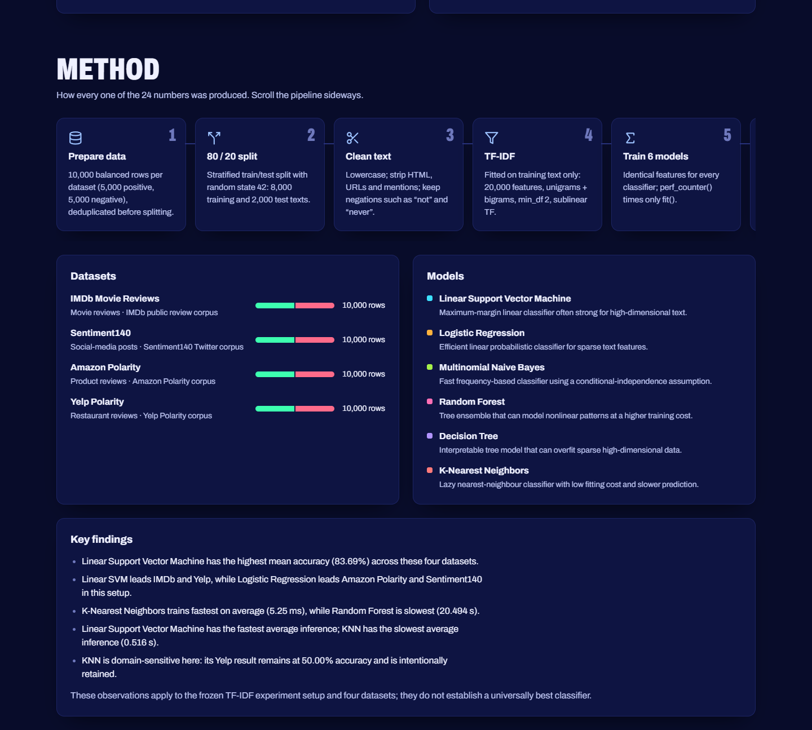
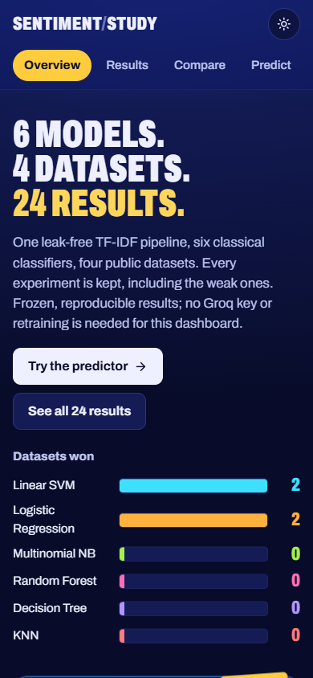

# Sentiment Analysis — Comparative Machine Learning Study

Six classical ML classifiers (Logistic Regression, Naive Bayes, Linear SVM, Random Forest, Decision Tree, KNN) are compared on four public sentiment datasets (IMDb, Sentiment140, Amazon, Yelp) under one leak-free TF-IDF pipeline — 24 frozen, reproducible experiments. A FastAPI backend serves the saved results plus a live predictor backed by the 24 saved `.joblib` models. A React + Vite dashboard ("Counting Night" theme, light mode default, dark mode optional) presents the comparison, and an optional product-report feature scores Reddit posts or uploaded reviews with VADER and asks a Groq LLM to summarize them.

## Screenshots

| Overview (light) | Overview (dark) |
|---|---|
|  |  |

| Results heatmap | Compare charts |
|---|---|
|  |  |

| Six-model vote | Product report |
|---|---|
|  |  |

| Method / findings | Mobile |
|---|---|
|  |  |

## Quick start

Requires **Python 3.12** and **Node.js 20+** (pinned pandas/scikit-learn and Vite need these).

```powershell
py -3.12 -m venv .venv
.\.venv\Scripts\python.exe -m pip install -r requirements.txt
npm ci
.\run-dev.ps1
```

`run-dev.ps1` starts the FastAPI backend (`http://localhost:8000`) and the Vite frontend (`http://localhost:5173`) in separate windows. Open `http://localhost:5173`.

`requirements.txt` holds only what the dashboard, prediction API, optional Groq report and tests need. The heavy PyTorch/transformers stack for the unfinished Phase 4 benchmark (see below) lives in the optional `requirements-transformers.txt` — not needed to run or demo the project; transformer-only tests are skipped automatically when it is absent.

## Features

- **Overview, Results, Compare, Predict** dashboard sections, all reading from the frozen `results/results.json` — nothing retrains on page load.
- **Results heatmap/table**: test accuracy per model × dataset, with each dataset's actual winning cell marked — never a styling choice.
- **Compare charts**: mean accuracy/F1 ranking and a speed-vs-accuracy view of the training/inference cost trade-off.
- **Six-model vote**: type text, pick a dataset, and let all six saved models for that dataset classify it; ties are shown explicitly as a split decision rather than forced to a winner.
- **CSV download** of the full results table from the Results section.
- **Light/dark toggle** — light is the default theme.
- **Product report** (optional, separate from the academic comparison): put a Groq key in `.env`, press **Test Groq key**, then analyze a Reddit URL/subreddit or an uploaded CSV, or press **Use the sample file** for an instant demo.

## Research objective

Compare Logistic Regression, Multinomial Naive Bayes, Linear Support Vector Machine, Random Forest, Decision Tree, and K-Nearest Neighbors across IMDb, Sentiment140, Amazon Polarity, and Yelp Polarity using predictive quality and computational-efficiency metrics.

## Datasets

Each prepared dataset contains up to 10,000 genuine, deduplicated examples: 5,000 negative and 5,000 positive reviews/posts. The normalized schema is `text,label`, where `0 = negative` and `1 = positive`.

| Dataset | Domain | Prepared samples |
|---|---|---:|
| IMDb Movie Reviews | Movie reviews | 10,000 |
| Sentiment140 | Social-media posts | 10,000 |
| Amazon Polarity | Product reviews | 10,000 |
| Yelp Polarity | Restaurant reviews | 10,000 |

Source revisions, deterministic sampling, and provenance are recorded in `datasets/manifest.json` when datasets are prepared.

## Models

- **Logistic Regression** — efficient linear probabilistic classifier for sparse text.
- **Multinomial Naive Bayes** — fast frequency-based baseline with a conditional-independence assumption.
- **Linear SVM** — maximum-margin linear classifier for high-dimensional feature spaces.
- **Random Forest** — nonlinear tree ensemble with greater computational cost.
- **Decision Tree** — interpretable tree model that can overfit sparse data.
- **KNN** — lazy nearest-neighbour model with low fitting cost and potentially expensive inference.

## Methodology

```text
Prepared data → deduplication → 80/20 stratified split → text cleaning
→ train-only TF-IDF → classifier fitting → test prediction → evaluation
→ artifact and result persistence
```

- Random state: `42`
- Split: 80% train / 20% test, stratified where possible
- TF-IDF: up to 20,000 features, unigrams/bigrams, `min_df=2`, negation-safe stop words
- Precision, Recall, F1: weighted average with `zero_division=0`
- Timings: `perf_counter()` around classifier fitting and test-set prediction only

TF-IDF is fitted only on training text. Deduplication happens before splitting, and normalized train/test text overlap is checked to prevent leakage.

## Frozen results

The canonical 4 × 6 baseline is stored in:

- `results/results.json`
- `results/results.csv`
- `results/EXPERIMENT_METADATA.md`

Do not rerun or overwrite these results for normal dashboard use. The dashboard and `GET /ml/summary` derive their conclusions directly from those records.

| Dataset | Best model | Accuracy | F1 |
|---|---|---:|---:|
| IMDb Movie Reviews | Linear SVM | 90.25% | 90.25% |
| Sentiment140 | Logistic Regression | 71.40% | 71.38% |
| Amazon Polarity | Logistic Regression | 84.25% | 84.25% |
| Yelp Polarity | Linear SVM | 90.35% | 90.35% |

Linear models have the strongest average predictive results in this setup. KNN has minimal fitting cost but substantially slower inference and weak Sentiment140/Yelp outcomes. Random Forest has a much higher training cost on these sparse TF-IDF features. See [docs/ACADEMIC_RESULTS.md](docs/ACADEMIC_RESULTS.md) for the complete analysis.

## Limitations and future scope

This study uses classical models, binary labels, deterministic 10,000-sample subsets, and no hyperparameter optimization. TF-IDF does not capture deeper contextual semantics, and timing depends on the hardware and system load. Future work could evaluate tuned models, cross-validation, contextual embeddings/transformers, multilingual or aspect-based sentiment, full datasets, and model explainability.

**Phase 4 transformer extension:** future work (started) — 3 of 24 planned runs complete, not part of the frozen baseline. See [docs/PHASE4_BENCHMARK_EXECUTION.md](docs/PHASE4_BENCHMARK_EXECUTION.md).

## Dataset preparation and experiment regeneration

The canonical results are already included for submission. Only regenerate datasets/artifacts when intentionally rebuilding the academic baseline:

```powershell
python -m ml.prepare_datasets
python -m ml.experiment_runner --all
```

Raw source downloads are optional and can be recreated by the preparation command. The prepared datasets and `.joblib` artifacts are retained because they are required for the frozen dashboard and real prediction flow.

## Product report: current Groq models

The product report calls `openai/gpt-oss-120b` (heavy) and `openai/gpt-oss-20b` (light) on Groq. Earlier Llama-based models were retired and are no longer used anywhere in this project.

## Troubleshooting

- **Reddit requests return 403 (blocked)** — Reddit often blocks unauthenticated requests from cloud/shared IPs. Use the **Use the sample file** button or upload your own CSV instead; the file-upload path doesn't touch Reddit at all.
- **Groq key missing or rejected** — put `GROQ_API_KEY=gsk_...` in `.env` (no restart needed), then press **Test Groq key**. A missing key still lets the rest of the dashboard run; only the product report needs it.
- **Port 8000 or 5173 already in use** — stop whatever is bound to that port, or edit the port in the `uvicorn`/`npm run dev` commands (and update `vite.config.js`'s proxy target if you change 8000).
- **Windows blocks the `regex` package install** — `requirements.txt` pins `regex==2024.11.6` because newer wheels are sometimes blocked by Windows Application Control. Don't upgrade this pin on Windows unless you've confirmed the newer wheel installs cleanly.
- **pytest fails with temp-folder/path errors on Windows** — Python's `tempfile` can hit Windows' `MAX_PATH` limit under a long user profile path. Point `TMP`/`TEMP` at a short path before running tests, e.g. `$env:TMP = 'C:\t'; $env:TEMP = 'C:\t'` (create `C:\t` first), then rerun `pytest`.

## Submission ZIP checklist

Include the source files, `requirements.txt`, `package.json`, `package-lock.json`, `settings.json`, `.env.example`, `docs/`, `results/`, `datasets/manifest.json`, all four files in `datasets/processed/`, all 24 `models/*.joblib` files plus `models/README.md`, and `screenshots/`. These prepared datasets and artifacts are required to view the frozen evidence and make predictions without retraining.

Do **not** include `.env`, `.venv/`, `node_modules/`, `dist/`, `runtime/`, caches, `datasets/raw/`, or `models/smoke/` (Phase 4 transformer checkpoints). A Groq key is optional; it enables only the separate product-analysis feature, not the academic dashboard or prediction endpoint.

## Testing

```powershell
.\.venv\Scripts\python.exe -m pytest -q
.\.venv\Scripts\python.exe -m pip check
npm run lint
npm run build
```

For presentation and viva preparation, see [docs/ACADEMIC_RESULTS.md](docs/ACADEMIC_RESULTS.md) and [docs/VIVA_GUIDE.md](docs/VIVA_GUIDE.md).
